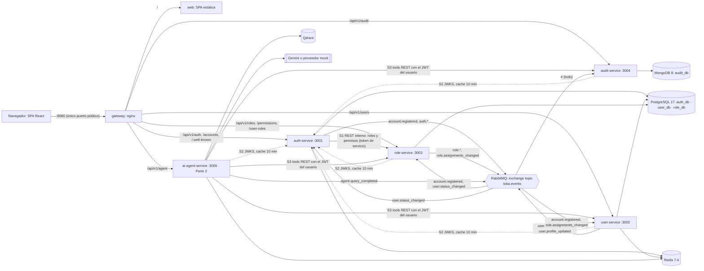
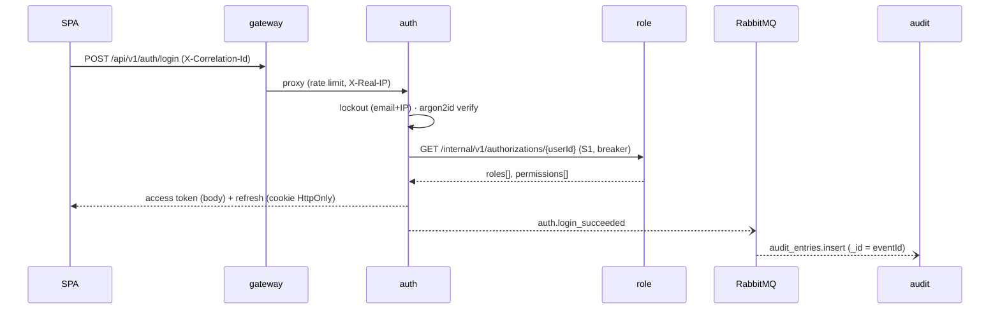

# Arquitectura: Toka User Platform

> Borrador del Checkpoint 1 (F0). Se completa en F4 con el SVG del diagrama, los ADRs y los
> flujos verificados contra el sistema corriendo.

## 1. Qué resuelve

Gestión de usuarios con **autenticación, autorización por roles y auditoría de accesos**,
construida como microservicios, más un **agente de IA** (Parte 2) que responde preguntas sobre
políticas internas (RAG) y consulta datos reales de los servicios con los permisos del usuario.

## 2. Vista general



Tres tipos de tráfico, con reglas distintas:

| Tráfico | Por dónde | Por qué |
|---|---|---|
| **Cliente → sistema** (norte-sur) | Siempre por el **gateway** nginx (:8080) | Un solo punto de entrada: ruteo, rate limit, headers de seguridad, correlation-id, logs de acceso. Ningún servicio publica puertos |
| **Servicio → servicio, síncrono** (este-oeste) | REST directo por la red interna de Docker, **sin** pasar por el gateway | Solo donde se necesita una respuesta inmediata: **S1** auth → role (permisos para el token), **S2** todos → JWKS de auth (llave pública, en cache), **S3** ai → user/role/audit (tools). Pasar por el gateway sería un salto extra y lo convertiría en punto único de falla interno |
| **Servicio → servicio, asíncrono** | Eventos en RabbitMQ | Todo lo que es "reaccionar a algo que pasó" (crear perfil, asignar rol por defecto, auditar). Desacopla disponibilidad: si audit cae, nadie más se entera |

## 3. Servicios y responsabilidades (bounded contexts)

| Servicio | Contexto | Dueño de | Store | Publica | Consume |
|---|---|---|---|---|---|
| **auth** | Identidad (IdP) | Cuentas, credenciales (hash argon2id), sesiones de refresh, llaves de firma | PG `auth_db`, Redis | `account.registered`, `auth.login_succeeded`, `auth.login_failed`, `auth.account_locked`, `auth.logout` | `user.status_changed` |
| **user** | Directorio | Perfil (nombre, área, puesto) y ciclo de vida (activo/suspendido) | PG `user_db`, Redis | `user.profile_updated`, `user.status_changed` | `account.registered` (crea el perfil), `role.assignments_changed` (proyección `user_roles_view`) |
| **role** | Control de acceso (RBAC) | Roles, asignaciones usuario↔rol (el catálogo de permisos es código en `@toka/contracts`) | PG `role_db` | `role.created/updated/deleted`, `role.assignments_changed` | `account.registered` (asigna `viewer` y alimenta `user_directory`), `user.status_changed` (estado en `user_directory`) |
| **audit** | Auditoría | Read model append-only de **todos** los eventos | Mongo `audit_db` | — | `#` (todos) |
| **ai-agent** (Parte 2) | Asistente | Base de conocimiento vectorizada, conversación, métricas de uso | Qdrant, Redis | `agent.query_completed` | — |
| **gateway** | Borde | Ruteo y políticas de borde | — | — | — |
| **web** | Hosting de la SPA | Archivos estáticos | — | — | — |

**Por qué auth es dueño de las credenciales y no user:** el password nunca cruza la red entre
servicios y el login no depende de que user-service esté arriba. user-service es dueño del
**perfil**; ambos comparten el mismo `id` (UUID) generado por auth.

## 4. Autenticación y autorización distribuidas

- **auth-service es el emisor (IdP).** Firma access tokens **JWT RS256** de 10 min con claims
  `iss, sub, aud, exp, jti, sid, email, roles[], permissions[]`.
- Publica `/.well-known/jwks.json` (llave pública) y `/.well-known/openid-configuration` con
  **solo los campos que realmente implementa** (subset honesto de OIDC Discovery).
- **Cada servicio valida el JWT localmente** con la llave pública (S2: JWKS en cache 10 min,
  refetch si llega un `kid` desconocido). Es la "validación distribuida" que acepta la prueba: no
  hay llamada a auth por request, y si auth cae los tokens vigentes siguen validándose mientras
  cada proceso tenga la llave en cache (un servicio que arranca con auth caído no puede validar
  hasta que auth vuelva).
- **El gateway no valida JWT** (zero-trust): un servicio no confía en que "alguien antes ya
  revisó". Guards globales *deny by default* en cada servicio: `JwtAuthGuard` +
  `PermissionsGuard` con `@RequirePermissions('users:write')`.
- **Refresh token** opaco, rotado en cada uso, en cookie `HttpOnly; SameSite=Strict`; en BD solo
  se guarda su hash SHA-256. El access token vive solo en memoria del navegador.
- **S1 (REST interno auth → role):** en login y refresh, auth pide los roles y permisos del
  usuario para meterlos en el token. Cliente resiliente: timeout 1 s, 2 reintentos con jitter,
  circuit breaker; si role cae, usa una copia en Redis de hasta 10 min; sin copia responde 503
  rápido (falla cerrado: nunca emite un token con permisos inventados).
- **Cómo se autentica S1 (también zero-trust):** auth, como emisor, firma para sí mismo un
  **token de servicio** de 60 s con la misma llave RS256 (`sub: "service:auth-service"`,
  `aud: "toka-internal"`, `token_use: "service"`, `scope: "authz:read"`). role lo valida con el
  mismo JWKS mediante un `ServiceAuthGuard` en las rutas `/internal/*`, que exige ese `aud`, ese
  `token_use` y el scope. Un token de usuario no sirve en `/internal/*` y un token de servicio no
  sirve en `/api/*`. Además, el gateway responde 404 a `/internal/*` (defensa en profundidad).
  El endpoint OAuth2 `client_credentials` para clientes externos queda como extra.

### Invariantes de autorización que cruzan servicios

- **"No se puede quitar ni suspender al último admin activo"** involucra datos de dos contextos:
  las asignaciones (role) y el estado del usuario (user). Cada lado mantiene una **proyección
  local** alimentada por eventos, sin llamadas síncronas:
  - role-service guarda `user_directory(userId, status, version)` desde `account.registered` y
    `user.status_changed`. Al quitar el rol `admin` cuenta los admins **activos** restantes; si
    quedaría cero, responde 409 `LAST_ADMIN`. También rechaza asignar roles a un usuario que no
    existe en su directorio.
  - user-service guarda `user_roles_view(userId, roles[], assignmentsVersion)` desde el snapshot
    de `role.assignments_changed`. Al suspender a un admin cuenta los admins activos restantes;
    si quedaría cero, responde 409 `LAST_ADMIN`. Esta misma proyección permite filtrar la lista
    de usuarios por rol sin llamar a role (CQRS).
- **Nadie se suspende a sí mismo ni se quita a sí mismo el rol `admin`** (se compara con el
  `sub` del token y se verifica contra la base propia, no contra el claim).
- **Límite conocido y documentado:** las proyecciones son eventualmente consistentes (normalmente
  milisegundos). Dos admins que se suspenden mutuamente en el mismo instante podrían pasar ambos
  chequeos. Para un dominio de administración de baja concurrencia se acepta; la mitigación es el
  script de recuperación del admin semilla y, en producción, serializar la operación (lock
  distribuido o un servicio dueño único de la invariante).

| Permiso | admin | auditor | viewer |
|---|---|---|---|
| `users:read`, `roles:read`, `agent:use` | ✓ | ✓ | ✓ |
| `users:write` (crear, editar, suspender) | ✓ | | |
| `roles:write`, `roles:assign` | ✓ | | |
| `audit:read` | ✓ | ✓ | |
| `kb:manage` | ✓ | | |

## 5. Flujos de datos

### 5.1 Login



### 5.2 Crear usuario (consistencia eventual)

1. La SPA (admin) llama `POST /api/v1/accounts` en auth.
2. auth crea la `Account` y publica `account.registered`.
3. En paralelo: user crea el perfil, role asigna `viewer` y audit registra el evento.
4. Los tres consumidores son **idempotentes** (tabla `processed_events` o `_id = eventId`), así
   que un reintento de RabbitMQ no duplica nada.

### 5.3 Suspender usuario

1. user-service valida las reglas: no suspenderse a sí mismo y no dejar el sistema sin admins
   activos (con su proyección `user_roles_view`).
2. Cambia el estado y publica `user.status_changed` (con `version` para descartar eventos viejos
   que lleguen desordenados).
3. auth lo consume y bloquea login y refresh; role actualiza su `user_directory`; audit registra.
4. El access token vigente del suspendido expira en ≤ 10 min (denylist documentada como siguiente
   paso).

### 5.4 Pregunta al agente (Parte 2)

El agente recupera pasajes de la base de conocimiento **filtrados por los permisos del usuario**
(ACL en Qdrant) y, si hace falta, llama tools de solo lectura **reenviando el JWT del usuario**:
cada servicio vuelve a autorizar, así que el agente nunca puede ver más que el usuario.

## 6. Mensajería

- Exchange **topic** `toka.events`; routing key = tipo de evento (`user.status_changed`).
- **Envelope versionado** y validado con zod en `@toka/contracts`:
  `eventId, type, version, occurredAt, producer, correlationId, actor, subject, data`.
- Cada cola tiene su `.retry` (TTL 5 s, vuelve a la cola original) y su `.dlq`. Tres intentos y
  luego DLQ; un mensaje inválido (schema) va directo a DLQ.
- Entrega *at-least-once* con consumidores idempotentes.

## 7. Datos: una herramienta por necesidad

| Store | Para qué | Por qué esta y no otra |
|---|---|---|
| **PostgreSQL 17** (1 contenedor, 3 bases, 1 usuario dueño por base) | Cuentas, perfiles, roles | ACID, restricciones únicas, bloqueo optimista con `version`. *Database-per-service lógico*: ningún servicio puede leer la base de otro (permisos de Postgres), sin pagar 3 contenedores en una laptop de 8 GB. SQL Server se descartó (≥ 2 GB de RAM y mal soporte arm64) |
| **MongoDB 8** | Auditoría | Append-only, payloads distintos por tipo de evento, consultas por rango de fechas con cursor. El usuario de la app **no puede** borrar ni actualizar (rol propio verificado en el spike) |
| **Redis 7.4** | Cache de permisos (S1), lockout de login, rate limits y presupuesto de tokens de IA | Contadores atómicos con TTL; si Redis falla, la cache degrada a *miss* |
| **Qdrant** (Parte 2) | Vectores de la base de conocimiento | Filtros por payload para el ACL, bajo consumo de RAM, arm64 |

ORM: **Prisma 7** en auth, user y role (schema declarativo, migraciones SQL versionadas, cliente
tipado; el dominio no conoce a Prisma porque los repositorios mapean Prisma ↔ dominio).
**Mongoose** en audit.

## 8. Arquitectura interna de cada servicio (Clean Architecture + DDD)

```
src/domain/          TS puro: agregados, value objects, eventos de dominio, puertos (interfaces)
src/application/     un caso de uso por clase (commands/ y queries/); depende solo de puertos
src/infrastructure/  adaptadores: Prisma/Mongoose + mappers, RabbitMQ, Redis, config validada
src/interface/http/  controllers delgados, DTOs con class-validator, health
prisma/              schema.prisma + migraciones SQL commiteadas
```

- La **regla de dependencias** (las capas internas no conocen a las externas) la verifica
  `dependency-cruiser` en `npm run lint:arch`, no solo la convención.
- **DDD pragmático:** DDD táctico completo donde vive la lógica de negocio (auth y role, user en
  versión ligera). audit es un subdominio de soporte: read model sin agregados de ceremonia.
- Paquetes compartidos, solo dos: `@toka/contracts` (lenguaje publicado: eventos, permisos,
  topología) y `@toka/nest-common` (plomería técnica: logs, errores, guards, AMQP, HTTP
  resiliente). Ningún servicio importa código de otro.

El detalle con ejemplos de código va en `docs/ddd-clean-architecture.md` (F4).

## 9. Observabilidad

- Logs **JSON** (pino) en todos los servicios y en el gateway, con `service`, `correlationId`,
  `userId`, `event` y `durationMs`; secretos redactados.
- **Correlation-id** de punta a punta: SPA → gateway → servicio → headers AMQP → consumidores.
  Una sola búsqueda (`jq 'select(.correlationId=="…")'`) reconstruye un flujo completo.
- `/health/live` (proceso) y `/health/ready` (solo el store propio, para no encadenar fallas).

## 10. Docker Compose

| Contenedor | Imagen | Red | Puerto host | Límite de memoria |
|---|---|---|---|---|
| gateway | `nginxinc/nginx-unprivileged:1.30.6-alpine` | edge + backend | **8080** | 64 MB |
| web | build propio (nginx sirviendo la SPA) | edge | — | 32 MB |
| auth, user, role, audit | build propio (`node:24.22.2-alpine`, multi-stage, usuario no root) | backend | — | 256 MB c/u |
| postgres | `postgres:17.11-alpine` | backend | — | 256 MB |
| mongo | `mongo:8.0.34` | backend | — | 512 MB |
| redis | `redis:7.4.12-alpine` | backend | — | 160 MB |
| rabbitmq | `rabbitmq:4.3.7-management-alpine` | backend | 127.0.0.1:15672 (UI) | 384 MB |
| qdrant, ai-agent (Parte 2) | `qdrant/qdrant:v1.20.0`, build propio | backend | — | 384 / 320 MB |

- Todo con **healthcheck** (rápido solo durante el arranque), `depends_on: service_healthy`
  hacia su propia infraestructura y reinicio automático.
- **Corre sin `.env`**: cada variable tiene default; sin `GEMINI_API_KEY` el agente usa el
  proveedor mock.
- Un comando: `docker compose up -d --build --wait`.
- `docker-compose.dev.yml` publica los stores en `127.0.0.1` con puertos desplazados, solo para
  desarrollo.

## 11. Decisiones descartadas (resumen; cada una tendrá su ADR)

| Alternativa | Por qué no |
|---|---|
| Keycloak como IdP | Cumple OIDC completo, pero cuesta ~500 MB de RAM y esconde justo lo que la prueba quiere evaluar. Queda como camino a producción (Auth Code + PKCE) |
| Kafka | Retención y replay que este dominio no necesita; RabbitMQ da routing por tópico, DLQ y menos operación |
| Validar JWT en el gateway | Rompe zero-trust: los servicios quedarían confiando en la red interna |
| BFF | Un salto más sin lógica propia que agregar; la SPA habla con el gateway en el mismo origen |
| Una instancia de Postgres por servicio | Correcto en producción; en una laptop de 8 GB se reemplaza por bases y usuarios separados |
